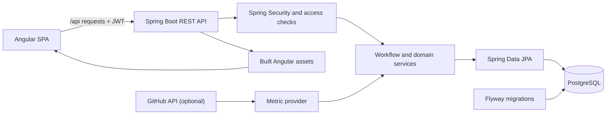

# KPI Performance Management Platform

## Project Overview

A full-stack KPI planning and performance-review platform for engineering
organizations. It connects configurable KPI templates to self-assessments,
manager reviews, evidence, scoring, calibration, and employee performance
history.

> **Upgrading an existing deployment?** Earlier versions created an
> administrator with a publicly known password. Changing the bootstrap
> configuration does not update existing accounts: change that password or
> disable the account before exposing the application. See
> [Bootstrap administrator](DEPLOYMENT_CONFIGURATION.md#bootstrap-administrator).

**Get started:** [Docker](#run-with-docker) ·
[Local development and demo data](#local-development) ·
[Tests](#tests-and-builds) · [Documentation](#documentation)

## Business Problem

Performance reviews need consistent goals, clear ownership, evidence, and
traceable decisions across organizational levels. Disconnected spreadsheets
and informal handoffs make that process harder to coordinate and review.

## Project Objectives

Provide a configurable workflow for setting, assessing, reviewing, and
publishing performance measures while keeping access scoped to the user's role
and organizational relationships.

## Target Users and Stakeholders

Employees, reporting managers, squad and organizational leads, administrators,
and people responsible for coordinating review cycles use different parts of
the application. Access depends on server-side roles and review scope.

## Key Capabilities

- **Plan:** define review cycles, KPI definitions, and weighted templates by role.
- **Generate and assess:** create employee KPIs, enter self-assessments, and
  attach evidence.
- **Review:** route submissions to reviewers, record decisions and feedback,
  and retain workflow history.
- **Calibrate and publish:** calculate weighted scorecards and track results
  through review, calibration, and publication.
- **Organize and notify:** use reporting relationships and active assignments to
  scope access, with in-app and optional email notifications.
- **Connect metrics:** optionally collect GitHub metrics as suggested actuals;
  employees decide whether to use them.

## End-to-End Business Workflow

1. An administrator configures the cycle, KPI definitions, and weighted role templates.
2. Employee KPIs are generated from eligible templates and assignments.
3. Employees submit self-assessments and supporting evidence.
4. Authorized reviewers assess the submissions, request rework or record decisions.
5. Scorecards are generated, reviewed, calibrated, and published for performance history.

## Solution Architecture



The Angular application is built into the Spring Boot artifact and served by the
same application in the packaged deployment. During frontend development,
Angular's dev server proxies `/api` requests to Spring Boot on port `8080`.

## Technology Stack

| Layer | Technology |
| --- | --- |
| Backend | Java 26, Spring Boot 4.1, Spring Security, Spring Data JPA |
| Frontend | Angular 21, TypeScript, RxJS |
| Database | PostgreSQL 17, Flyway |
| Testing | JUnit 5, Mockito, Vitest, Playwright |
| Packaging | Maven, Docker Compose |

## Important Technical and Delivery Decisions

The backend enforces access control independently of UI navigation. Flyway owns
schema changes, and external metrics are suggestions rather than automatic
employee submissions. The [architecture and delivery guide](docs/ARCHITECTURE_DELIVERY.md)
describes the implemented choices and proposed delivery practices without
claiming a particular historical process.

## Security and Access Control

JWT signing requires a unique secret of at least 64 bytes. First-time
non-development administrator setup requires explicit environment variables;
existing accounts are not reset. See the [deployment guide](DEPLOYMENT_CONFIGURATION.md)
and [permission matrix](RBAC_PERMISSION_MATRIX.md). Existing deployments must
replace any previously known administrator password.

## Database Design and Migration Strategy

PostgreSQL stores users, organizational assignments, KPI configuration,
workflow history, scorecards, and evidence metadata. Flyway applies versioned
migrations; Hibernate validates mappings instead of changing the schema. See
the [migration guide](DATABASE_MIGRATIONS.md) before modifying the database.

## API and External Integration Approach

The Angular client uses REST endpoints under `/api`. GitHub metrics are optional
and require a configured token, metric binding, and external identity. Collected
values remain suggestions until an employee uses them. Email delivery is
optional; the [deployment guide](DEPLOYMENT_CONFIGURATION.md) describes the
integration settings.

## Testing and Quality Assurance

The project includes backend unit and PostgreSQL integration tests, frontend
Vitest tests, and Playwright live and fixture-backed UI tests. Run them using
the commands in [Tests and builds](#tests-and-builds); use a disposable database.
The [delivery guide](docs/ARCHITECTURE_DELIVERY.md#proposed-quality-gates)
outlines proposed release gates.

## Deployment and Configuration

Docker Compose runs PostgreSQL and the packaged application locally. Runtime
secrets, CORS, storage, and profile settings are covered in the
[deployment guide](DEPLOYMENT_CONFIGURATION.md). The Compose defaults are
intended for local use, not a public production deployment.

## Screenshots and Application Demo

These screenshots were captured from a local application using the
[fictional development dataset](docs/DEMO_DATA.md):

| | |
|---|---|
| [Login](docs/screenshots/login.png) | [Dashboard](docs/screenshots/dashboard.png) |
| [Organization](docs/screenshots/organization.png) | [Configuration](docs/screenshots/configuration.png) |
| [Templates](docs/screenshots/templates.png) | [Self-assessment dashboard](docs/screenshots/reporting.png) |
| [Manager review](docs/screenshots/review.png) | [Scorecards](docs/screenshots/scorecards.png) |

Review future screenshots for confidential information and publication
permission before sharing.

## Known Limitations

- Login rate limits and token revocation are in memory, per instance; logout
  revocation does not survive a restart and does not propagate across instances.
- Existing deployments may still contain the former known bootstrap account.
- Uploaded evidence is stored on the application filesystem; backups and
  multi-instance storage need an operational solution.
- The template list can show zero items and weight even when items exist;
  inspect a template's details until the list response is corrected.
- Live end-to-end coverage is not a substitute for a full security or
  production-readiness assessment.
- This repository's ownership and permission to publish must be confirmed.

## Future Roadmap

Potential improvements, not commitments: shared session-revocation and rate
limit storage, stronger live workflow tests, documented backup and recovery,
and an API reference. Prioritize after security and publication review.

## Local Setup Instructions

### Run with Docker

For a local containerized instance, install Docker Engine with the Compose
plugin and OpenSSL. Run from the repository root:

```sh
cp .env.example .env
# Generate a key, then paste it into JWT_SECRET in .env.
openssl rand -base64 64
# Set BOOTSTRAP_ADMIN_EMAIL and a unique BOOTSTRAP_ADMIN_PASSWORD in .env.
docker compose up --build
```

Open <http://localhost:8080>. PostgreSQL is available on port `5432`, and
Flyway creates or migrates the schema at application startup. Database data and
uploaded evidence are stored in named Compose volumes. Stop the services with
`docker compose down`; it leaves those volumes intact.

The Compose configuration runs with the `prod` Spring profile; it does not load
the fictional development dataset. Sign in with the bootstrap credentials you
configured. For sample users and a populated review workflow, use local
development below.

### Local development

Prerequisites: Java 26, Docker Compose, Node.js 22, npm, and OpenSSL. The
commands below use the Compose defaults: PostgreSQL 17, database `kpi`, user
`kpi_user`, and password `kpi_pass`. If an existing `.env` customizes these
values, use matching `DB_URL`, `DB_USERNAME`, and `DB_PASSWORD` values.

Start the backend and database, then start the frontend in a second terminal:

```sh
# Terminal 1, from the repository root.
# Compose requires JWT_SECRET even when only the database service is started.
export JWT_SECRET="$(openssl rand -base64 64)"
docker compose up -d db
export SPRING_PROFILES_ACTIVE=dev
export DB_URL=jdbc:postgresql://127.0.0.1:5432/kpi
export DB_USERNAME=kpi_user
export DB_PASSWORD=kpi_pass
./mvnw spring-boot:run
```

```sh
# Terminal 2: run Angular with its /api proxy pointed at localhost:8080.
cd frontend
npm ci
npm start
```

Open <http://localhost:4200>. To use the fictional development accounts, start
the application with `dev` active and `prod` inactive. Sample credentials,
roles, and review scenarios are documented in
[`docs/DEMO_DATA.md`](docs/DEMO_DATA.md).

`docker compose down` stops the database without removing its data. Compose
database initialization settings apply when the database volume is first
created; changing the credentials later does not update an existing volume.

## Project structure

```text
.
├── src/
│   ├── main/java/com/example/kpi/
│   │   ├── controller/       REST endpoints
│   │   ├── service/          KPI workflows, scoring, organization, access control
│   │   ├── repository/       Spring Data persistence
│   │   ├── entity/           JPA domain entities
│   │   ├── dto/              API request and response models
│   │   ├── security/         JWT authentication, rate limiting, revocation
│   │   ├── config/           Spring, seed data, scheduling, and web configuration
│   │   ├── metrics/          External metric-provider integration
│   │   ├── mapper/           Entity and DTO mapping
│   │   └── exception/        Domain and API exception handling
│   ├── main/resources/
│   │   ├── db/migration/     Versioned Flyway SQL migrations
│   │   └── application*.yaml Environment and profile configuration
│   └── test/java/            Backend tests
├── frontend/
│   ├── src/app/components/   Standalone Angular screens and shared UI
│   ├── src/app/services/     API, authentication, permissions, and UI services
│   ├── src/app/models/       Frontend data contracts
│   └── e2e/                  Playwright end-to-end tests
├── tools/                    Smoke tests and migration utilities
├── docs/                     Maintained guides and historical archive
├── DATABASE_MIGRATIONS.md
├── DEPLOYMENT_CONFIGURATION.md
├── RBAC_PERMISSION_MATRIX.md
├── docker-compose.yml
└── pom.xml
```

### Tests and builds

From the repository root, run the frontend unit tests and production build:

```sh
cd frontend
npm test -- --watch=false
npm run build
```

Backend tests use PostgreSQL. From the repository root, start the Compose
database and configure the connection for a **disposable development/test
database** before running:

```sh
export JWT_SECRET="$(openssl rand -base64 64)"
docker compose up -d db
export DB_URL=jdbc:postgresql://127.0.0.1:5432/kpi
export DB_USERNAME=kpi_user
export DB_PASSWORD=kpi_pass
./mvnw test
```

Do not point tests or demo data at a production database. See
[`DEPLOYMENT_CONFIGURATION.md`](DEPLOYMENT_CONFIGURATION.md) for runtime
configuration and [`DATABASE_MIGRATIONS.md`](DATABASE_MIGRATIONS.md) before
changing entities or schema. For Playwright setup, test selection, and
isolation requirements, see [`frontend/e2e/README.md`](frontend/e2e/README.md).

## Troubleshooting

| Symptom | Check |
| --- | --- |
| Compose reports that `JWT_SECRET` is missing | Set it in `.env` or export it before running any Compose command. |
| Database authentication fails | Match the backend credentials to the existing Compose database volume; changing `.env` does not update an initialized database. |
| Port `5432`, `8080`, or `4200` is in use | Stop the conflicting service or configure a different port and update the corresponding connection or proxy settings. |
| Demo accounts are missing | Start with `dev` active and `prod` inactive, and check startup logs for seed errors. |
| Flyway rejects a migration | Check the migration and database history; do not edit an already applied migration or run repair without investigating. |

## Supporting Documentation

| Guide | Contents |
| --- | --- |
| [`DATABASE_MIGRATIONS.md`](DATABASE_MIGRATIONS.md) | Flyway ownership, migration workflow, and schema verification |
| [`DEPLOYMENT_CONFIGURATION.md`](DEPLOYMENT_CONFIGURATION.md) | Profiles, environment variables, security settings, and operations |
| [`RBAC_PERMISSION_MATRIX.md`](RBAC_PERMISSION_MATRIX.md) | Server-side authorization model and frontend route gates |
| [`docs/DEMO_DATA.md`](docs/DEMO_DATA.md) | Fictional development users and review scenarios |
| [`docs/ARCHITECTURE_DELIVERY.md`](docs/ARCHITECTURE_DELIVERY.md) | Requirements, architecture, and proposed delivery practices |
| [`frontend/README.md`](frontend/README.md) | Frontend development and build |
| [`frontend/e2e/README.md`](frontend/e2e/README.md) | Live Playwright tests and isolated UI audit |
| [`docs/README.md`](docs/README.md) | Documentation index and archive notes |
| [`CONTRIBUTING.md`](CONTRIBUTING.md) | Contribution workflow |
| [`SECURITY.md`](SECURITY.md) | Private security reporting |

The dated end-to-end guide in `docs/` is a historical snapshot; follow the
current guides above for implementation and deployment details.

## License

[MIT](LICENSE)
