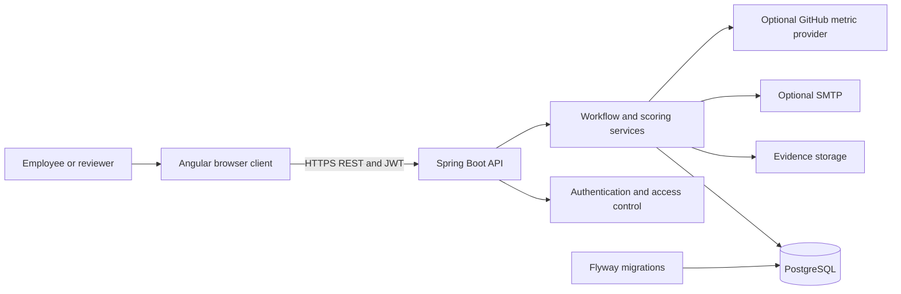

# Architecture and delivery overview

This guide describes the implemented system and proposes a lightweight delivery
framework. It does not assert that a particular project process, approval, or
historic decision discussion took place.

## Business requirements

**Problem and objective:** provide a consistent process for assigning,
assessing, reviewing, and publishing weighted KPIs across an organization.

| Area | Requirement |
| --- | --- |
| Stakeholders | Employees, reviewers, organizational leads, administrators, and review-cycle coordinators |
| Functional scope | Configure cycles and templates; generate KPIs; submit assessments and evidence; review, score, calibrate, and publish |
| Non-functional needs | Server-side authorization, auditable transitions, secure configuration, testability, and recoverable persistent data |
| Outside current scope | Payroll decisions, identity-provider integration, and automatic acceptance of third-party metric values |
| Assumptions | An administrator maintains roles, assignments, templates, and review cycles; each environment controls its own credentials |
| Constraints | PostgreSQL and Flyway own persistence; token revocation and login limits are instance-local; uploaded files need persistent storage |

Acceptance should be demonstrated with an isolated dataset: configure a cycle
and template, generate an employee KPI, submit and review it, and verify that
the resulting scorecard follows the publication and access rules. These are
proposed acceptance criteria, not a claim that every scenario is automated.

## Solution architecture

In the packaged deployment, Spring Boot serves the Angular bundle. A user
signs in through the authentication API; subsequent API calls carry an access
token and the backend evaluates roles and organizational scope. Workflow
services read and write through repositories, while Flyway maintains the schema.
GitHub metric collection requires a configured connector, KPI binding, and
employee identity. Evidence metadata is in PostgreSQL and uploaded files are
stored separately on disk.

## Implemented technical choices

These are observations of the current code, not invented historical decisions:

| Choice | Current implementation and implication |
| --- | --- |
| Angular and Spring Boot | Separate client and server responsibilities; packaged deployment serves both from one application |
| PostgreSQL and Flyway | Versioned database changes; Hibernate validates entity mappings |
| Server-side permissions | UI guards aid navigation, but the API decides access using roles and reporting relationships |
| JWT | Stateless signed access tokens; current revocation is in-memory and instance-local |
| Configurable hierarchy | Assignments and reporting relationships inform review scope |
| Weighted workflow | Role templates generate KPIs; scorecards support review and calibration before publication |
| Metric providers | External data is an optional suggestion, not an automatic submitted actual |
| Containers | Compose supplies a local database and application with persistent volumes |

## Proposed delivery and governance

Prioritize confidentiality and authorization first, then workflow correctness,
operational reliability, and usability. A practical sequence is: establish a
safe baseline; validate critical review flows; prepare deployment and recovery
procedures; then evaluate optional enhancements.

Dependencies include approved publication rights, a supported runtime,
PostgreSQL, a JWT secret, initial administrator credentials, and a suitable
persistent evidence store. Risks include exposure of employee performance data,
incorrect review scope, configuration errors, and loss of uploaded files.
Multi-instance deployment requires a shared design for rate limiting and
revocation.

### Proposed quality gates

- Review requirements, privacy impact, authorization, migrations, and rollback.
- Run backend and frontend tests, production builds, and relevant browser tests
  against disposable data. Investigate failures rather than accepting skips as
  coverage.
- Verify backup and restore, configuration, access boundaries, and deployment
  health in an isolated environment before release.
- Confirm ownership and publication approval before making source, artifacts,
  screenshots, or sample data public.

AI-assisted development, if used, should be treated as implementation and
documentation assistance subject to human review and validation. This is
distinct from product functionality: no generative-AI feature is claimed here.
Author contributions and the tools used for this project require confirmation
before publishing attribution.
